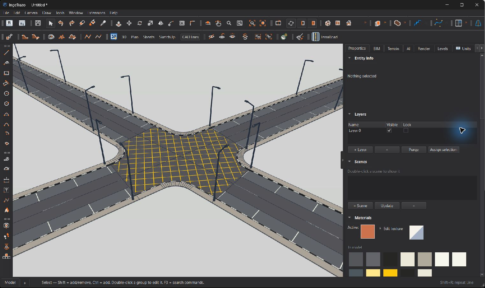
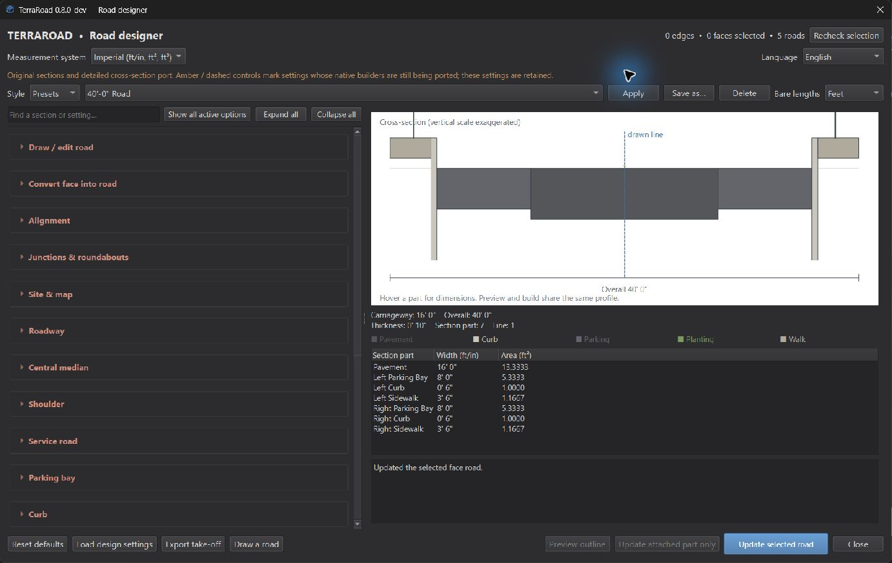

# TerraRoad — getting started

For **TerraRoad 0.8.0-dev** in **IngeTrazo 0.5.9**. This is a development
preview: controls with amber/dashed styling may be retained from the SketchUp
edition while their native builders are unfinished. Use **Show all active
options** to concentrate on the implemented tools.

## Install and open

1. Download `TerraRoad-IngeTrazo-0.8.0-dev-catalog.zip` from this repository's
   Releases. It is the IngeTrazo Python package, not a SketchUp RBZ.
2. Once TerraRoad is listed, use IngeTrazo's extension manager. For manual
   installation, extract the complete `terraroad` folder into IngeTrazo's
   plugins folder. On Windows, the usual location is
   `%APPDATA%\ingetrazo\plugins\terraroad\__init__.py`.
3. Keep `_TerraRoad` and `assets.json` inside that package. Restart IngeTrazo.
4. Click **TerraRoad** on the toolbar or open it from **Extensions**. The
   designer's sections start collapsed; click a section heading to open it.

For an older loose installation, first back up `preferences.ini` and
`user_styles.json` from its `_TerraRoad` folder. Keep a backup of the old
plugin, then remove the old `TerraRoad.py` and its sibling `_TerraRoad` folder
from the active plugins directory before installing the package. Loading both
editions can duplicate commands. Saved model files should be kept.

## Choose units, language and a style

Use **Measurement system** at the top for metric or imperial display and
**Language** for the interface language. Some technical notes remain English.
Explicit units work in dimensions, for example `7m`, `150mm`, `24ft` or
`6' 6"`. The **Bare lengths** selector determines how numbers without unit
suffixes are interpreted. Geometry is stored internally in metres.

Choose a preset in **Style**, then click **Apply**. Expand **Roadway**, **Curb**,
**Sidewalk**, **Central median**, **Parking bay** and other sections to adjust
the profile. Check the live cross-section and overall width before building.
Use **Save as…** to keep a reusable style.

## Make your first road

1. Start in an empty area of the model and configure the road section.
2. Click **Draw a road** at the bottom of the TerraRoad designer.
3. Click the first centerline point, then another point. A road is generated.
4. Continue clicking: each next segment extends the same road. You can enter a
   length using IngeTrazo's native input while pointing in the desired direction.
5. Press **Enter** or double-click to finish that chain. Click again to start
   another road; **Esc** cancels the current unfinished drawing operation.

Alternatively, draw an open connected chain with IngeTrazo's line tool, select
the edges, open TerraRoad and click **Create**. For a first test, use one
straight line at least 50 m long. A very short segment or tight corner may not
fit a wide road profile; lengthen it or change the width/radius.

## Add branches and junctions

Start **Draw a road**, click on an existing TerraRoad road and draw outward.
The click snaps to that road's centerline and the branch rebuilds the connected
network with a junction. The branch inherits the clicked road's style.

For an existing layout, select intersecting lines or TerraRoad roads. Open
**Junctions & roundabouts** and use **Build junctions / roundabouts from lines
or roads**. Use level approaches for the network builder. Generated roads and
junctions become separate groups, with component parts inside.

For a roundabout, choose the roundabout crossing type and set the island,
circulatory and entry dimensions. Automatic radius can enlarge the island to
fit the approaches. Keep approach lines long enough for the entry curves.
Undivided approaches do not acquire triangular medians. A road median is
controlled by its section settings. Yellow keep-clear boxes are for ordinary
junctions and are suppressed on roundabouts.

## Convert a face into a road

Select a planar face, open TerraRoad and expand **Convert face into road**.
Set the section/accessories and click **Convert to a road**. Identifiable road
strips are open at both ends by default; **Open road ends** controls this.
Start with a long rectangle. Complex branched face layouts work better when
split into separate road and junction pieces. Curved/adaptive face layouts
remain limited in this development build.

## Curbs, markings and accessories

- In **Curb**, enable curb painting and set the block length to alternate
  colors. Use the material choices for dark and light curb blocks. Keep curb
  height and width appropriate for the model scale.
- Use **Parking bay** for the side, angle and stall dimensions, and enable
  parking markings. **Lane marking** controls center, divider and edge paint.
- Configure street-light placement and spacing in the light-pole settings.
  Configure traffic signals and pedestrian crossings in their sections.
- For existing geometry, select the relevant road/junction, load its settings,
  change them, then click **Update selected road**. Changing a control alone
  does not repaint/rebuild an existing object.

## Edit a generated design

Right-click a TerraRoad object to see its applicable edit, rebuild and style
commands. Use **Draw / edit road** in the designer for centerline editing tools.
Double-click a road or junction group and then a component to edit an individual
part with IngeTrazo's native tools.

Save a copy before substantial edits. A TerraRoad rebuild regenerates geometry
from its saved parameters and replaces manual component edits. Branch creation
also rebuilds the connected network. Use Undo to recover the previous result.

## Maps and road tracing

1. Expand **Site & map**, set a site using latitude/longitude or a full Google
   Maps link, and set map width and north rotation. A Google Maps link supplies
   location; it does not imply that Google imagery is downloaded.
2. Place a provider map, or use **Choose a local map picture…**. A local image
   needs the correct geographic center, physical width and north rotation.
3. For **Crop map**, select a crop face/edges, or click two opposite corners
   when prompted. The preview is a rectangle in the map's axes.
4. Automatic tracing imports OpenStreetMap road centerlines. Click an imported
   road to select it, **Shift-click** to add roads, and press **Enter** to return
   to TerraRoad. Click **Create** to build from the selected trace.
5. For roads absent from OSM or displaced from the image, use **Trace roads
   manually on the map…** and click points along the visible road centerline.
   Finish the chain and use the selected trace to create a road.

Automatic tracing is not image recognition. Estimated road edges are based on
mapped width/lane information; they are not surveyed boundaries. Map/road
services need internet access and may be unavailable or incomplete. Provider
attribution and usage terms still apply. Enter optional Cesium credentials only
in your own settings; never upload preferences or cached imagery to an issue.

## Quantities and saving

Use **Export take-off** to save a CSV quantity report for the TerraRoad design
objects available in the model. Review its units and scope before relying on
the quantities. Save the model in IngeTrazo's `.igz` format to retain editable
groups, components and TerraRoad parameters.

## If something does not work

| Symptom | What to check |
| --- | --- |
| No TerraRoad toolbar or menu | Restart IngeTrazo; check the complete package is in the plugins folder and enabled. Check there is only one installed TerraRoad edition. |
| Create reports invalid centerlines | Select connected open edges. Remove duplicate/zero-length lines; use the junction builder for branches. |
| A branch or roundabout cannot fit | Lengthen approaches, reduce road width or adjust entry/island radii. |
| Curb colors have not changed | Enable curb painting and update/rebuild the selected object. |
| A map from an older TerraRoad build is mirrored | Open the 0.8 designer to run the undoable frame repair. Retrace after correcting the map. |
| Traces differ from satellite imagery | Check center, width, rotation and crop; use manual tracing where OSM differs. |
| A control is grey or amber | Its native operation may still be unfinished. Read `PORT_STATUS.md`; use Show all active options. |

Report problems through this repository's Issues with TerraRoad/IngeTrazo
versions, selected tool, steps to reproduce and a screenshot. Share only a
minimal example model that you are comfortable making public.
